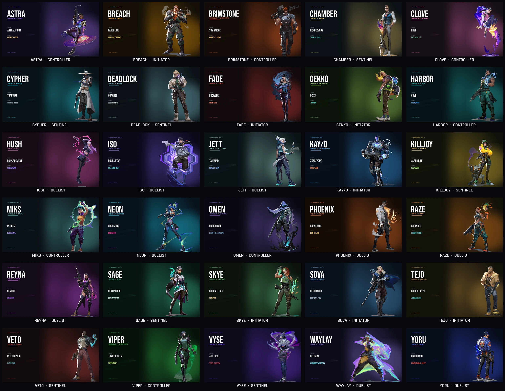

# VALORANT Agent Themes for Omarchy

**30 independent Omarchy themes — one for every agent in VALORANT.** Each palette is
built from that agent's signature ability and ultimate, not from a generic colour wheel:
Viper gets toxic green, Reyna soul-purple, Neon electric cyan, Phoenix fire orange,
Deadlock ice-blue steel, and so on.



Every theme ships with:

- a dark `colors.toml` used by Omarchy for the shell, Hyprland, terminals, btop,
  Neovim, VS Code, btop and the rest of the themed apps;
- a branded **3840×2160** signature wallpaper named after the agent and its two key
  abilities;
- the collected agent artwork, re-encoded as high-quality WebP at up to 4K;
- a matching Yaru icon theme.

The whole bundle lives in this one repository, but every agent is a separate,
independently installable theme.

---

## Requirements

- [Omarchy](https://omarchy.org/) (Hyprland + the `omarchy` CLI)
- `git` and `bash` for installation
- `python3` is used only to read `agents.json` for pretty listing; install still works
  without it.

---

## Install

Clone the bundle once:

```bash
git clone https://github.com/m7sh/valorant-themes.git
cd valorant-themes
```

### All 30 themes with one command

```bash
./install.sh
```

### Just one agent

```bash
./install.sh jett
```

### Several agents

```bash
./install.sh jett reyna viper
```

Agent names are case-insensitive, and `valorant-` prefixes are accepted:

```bash
./install.sh Jett
./install.sh valorant-jett
```

### Install and apply immediately

```bash
./install.sh --set jett
```

### One-command remote install

```bash
curl -fsSL https://raw.githubusercontent.com/m7sh/valorant-themes/main/bootstrap.sh | bash
```

Only one agent:

```bash
curl -fsSL https://raw.githubusercontent.com/m7sh/valorant-themes/main/bootstrap.sh | bash -s -- jett
```

### Other installer options

```bash
./install.sh --list               # list every agent, role, signature and ultimate
./install.sh --link jett          # symlink to the repo instead of copying
./install.sh --remove jett        # remove one theme
./install.sh --remove all         # remove every valorant-* theme
./install.sh --force              # reinstall over existing copies
./install.sh --dry-run            # show what would happen
./install.sh --help
```

Themes are copied to `~/.config/omarchy/themes/valorant-<agent>`, so Omarchy sees
them like any other theme:

```bash
omarchy theme list
omarchy theme set valorant-jett
omarchy theme bg next      # cycle that agent's wallpapers
```

---

## The roster

| Agent | Role | Signature | Ultimate | Theme | Accent |
|---|---|---|---|---|---|
| **Astra** | Controller | Astral Form | Cosmic Divide | `valorant-astra` | `#A97BFF` |
| **Breach** | Initiator | Fault Line | Rolling Thunder | `valorant-breach` | `#F59E0B` |
| **Brimstone** | Controller | Sky Smoke | Orbital Strike | `valorant-brimstone` | `#FF6B2C` |
| **Chamber** | Sentinel | Rendezvous | Tour De Force | `valorant-chamber` | `#E8C46A` |
| **Clove** | Controller | Ruse | Not Dead Yet | `valorant-clove` | `#FF7AC6` |
| **Cypher** | Sentinel | Trapwire | Neural Theft | `valorant-cypher` | `#2DD4E8` |
| **Deadlock** | Sentinel | GravNet | Annihilation | `valorant-deadlock` | `#8FD8E8` |
| **Fade** | Initiator | Prowler | Nightfall | `valorant-fade` | `#E2453F` |
| **Gekko** | Initiator | Dizzy | Thrash | `valorant-gekko` | `#B8F26B` |
| **Harbor** | Controller | Cove | Reckoning | `valorant-harbor` | `#2FD0C8` |
| **Hush** | Duelist | Displacement | Suspension | `valorant-hush` | `#E85BB5` |
| **Iso** | Duelist | Double Tap | Kill Contract | `valorant-iso` | `#8C6BFF` |
| **Jett** | Duelist | Tailwind | Blade Storm | `valorant-jett` | `#B8F5E8` |
| **KAY/O** | Initiator | ZERO/point | NULL/cmd | `valorant-kayo` | `#3FA9FF` |
| **Killjoy** | Sentinel | ALARMBOT | Lockdown | `valorant-killjoy` | `#FFD23F` |
| **Miks** | Controller | M-pulse | Bassquake | `valorant-miks` | `#6FD8CE` |
| **Neon** | Duelist | High Gear | Overdrive | `valorant-neon` | `#22E0FF` |
| **Omen** | Controller | Dark Cover | From the Shadows | `valorant-omen` | `#9270E8` |
| **Phoenix** | Duelist | Curveball | Run it Back | `valorant-phoenix` | `#FF7A2F` |
| **Raze** | Duelist | Boom Bot | Showstopper | `valorant-raze` | `#FF8A1F` |
| **Reyna** | Duelist | Devour | Empress | `valorant-reyna` | `#C44BE0` |
| **Sage** | Sentinel | Healing Orb | Resurrection | `valorant-sage` | `#45D6A5` |
| **Skye** | Initiator | Guiding Light | Seekers | `valorant-skye` | `#6FD88F` |
| **Sova** | Initiator | Recon Bolt | Hunter's Fury | `valorant-sova` | `#5AA9E6` |
| **Tejo** | Initiator | Guided Salvo | Armageddon | `valorant-tejo` | `#E0A84E` |
| **Veto** | Sentinel | Interceptor | Evolution | `valorant-veto` | `#C2453F` |
| **Viper** | Controller | Toxic Screen | Viper's Pit | `valorant-viper` | `#3FE05F` |
| **Vyse** | Sentinel | Arc Rose | Steel Garden | `valorant-vyse` | `#7A3FF2` |
| **Waylay** | Duelist | Refract | Convergent Paths | `valorant-waylay` | `#A78BFA` |
| **Yoru** | Duelist | Gatecrash | Dimensional Drift | `valorant-yoru` | `#3B5BFF` |

---

## What each theme contains

```
themes/valorant-jett/
├── colors.toml                  # the palette Omarchy applies
├── icons.theme                  # matching Yaru icon variant
└── backgrounds/
    ├── 0-jett-signature.webp    # branded 3840x2160 signature wallpaper
    ├── 1-jett1.webp             # collected artwork, up to 4K
    ├── 2-jett2.webp
    └── ...
```

The `0-` wallpaper is always the signature piece, so a freshly applied theme
immediately shows the agent and its abilities. Extra backgrounds can be cycled with
`omarchy theme bg next`.

## How the colours are chosen

Each agent has a primary **ability accent** and a secondary **ultimate accent**:

- the signature ability sets the accent, cursor, selection and glow colour;
- the ultimate tints the secondary highlights and the ANSI bright slots;
- the background is a very dark, hue-shifted version of the same accent;
- terminal colours keep their semantic meaning (red still reads as red) but are
  blended 22% toward the agent accent, so errors and diffs stay readable while the
  whole desktop stays in character.

For example, Viper's toxic green (`#3FE05F`) with acid-yellow ultimate accents
produces a near-black green desktop, while Chamber's gold (`#E8C46A`) and teal
(`#4FD1C5`) produce a warm, tailored dark palette.

## Rebuilding or adding an agent

The bundle is reproducible:

```bash
python3 tools/fetch-assets.py        # re-download agent renders and fonts
python3 tools/build.py                # regenerate palettes and all wallpapers
python3 tools/build.py --no-walls     # regenerate colours only (fast)
python3 tools/build.py --only jett    # one agent
```

Agent metadata lives in the `AGENTS` table at the top of `tools/build.py`. Add a row
for a new agent and run the script; it creates the theme, the branded wallpaper and
updates `agents.json`. The branded wallpaper is composited from the official agent
render in `assets/portraits/` using the fonts in `assets/fonts/`.

## Credits and fan-content notice

This is an unofficial fan project. **VALORANT and all agent artwork are property of
Riot Games, Inc.** It is not affiliated with, endorsed by, or sponsored by Riot Games.

- Agent renders: [valorant-api.com](https://valorant-api.com/)
- Fonts: [Bebas Neue](https://github.com/dharmatype/Bebas-Neue) and
  [Rajdhani](https://github.com/itfoundry/rajdhani), both SIL Open Font License.
- Collected wallpapers: the bundle owner's collection; re-encoded to WebP for size.
- Theme code and build scripts: MIT (see `LICENSE`).

See `CREDITS.md` for details.
