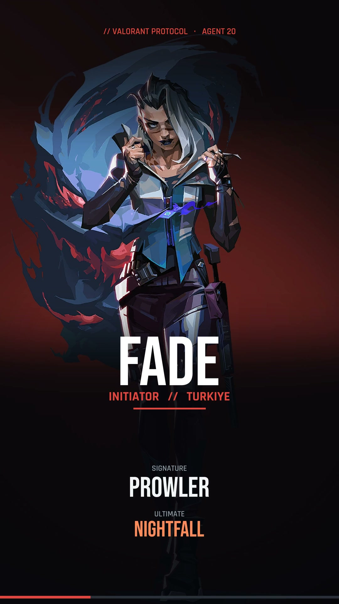

# VALORANT Agent Themes for Omarchy

**30 independent Omarchy themes — one for every agent in VALORANT.** Each palette is
built from that agent's signature ability and ultimate, not from a generic colour wheel:
Viper gets toxic green, Reyna soul-purple, Neon electric cyan, Phoenix fire orange,
Deadlock ice-blue steel, and so on.


Every theme ships with:

- a dark `colors.toml` used by Omarchy for the shell, Hyprland, terminals, btop,
  Neovim, VS Code, btop and the rest of the themed apps;
- a branded **3840×2160** signature wallpaper named after the agent and its two key
  abilities;
- the collected agent artwork, re-encoded as high-quality WebP at up to 4K;
- a theme switcher **preview card**, a per-agent `shell.toml` (bar accent and
  Hyprland border gradient), and a branded **Plymouth boot logo**;
- a matching Yaru icon theme.

The whole bundle lives in this one repository, but every agent is a separate,
independently installable theme.

## Short video

A 15-second 9:16 montage (1080×1920, silent) for Shorts, Reels and TikTok:

[](assets/valorant-themes-short.mp4)

[Download / play `valorant-themes-short.mp4`](assets/valorant-themes-short.mp4) ·
re-render with `python3 tools/make_short.py`

---

## Requirements

- [Omarchy](https://omarchy.org/) (Hyprland + the `omarchy` CLI)
- `git` and `bash` for installation
- `python3` is used only to read `agents.json` for pretty listing; install still works
  without it.

---

## Install

Clone the bundle once:

```bash
git clone https://github.com/m7sh/valorant-themes.git
cd valorant-themes
```

### All 30 themes with one command

```bash
./install.sh
```

### Just one agent

```bash
./install.sh jett
```

### Several agents

```bash
./install.sh jett reyna viper
```

Agent names are case-insensitive, and `valorant-` prefixes are accepted:

```bash
./install.sh Jett
./install.sh valorant-jett
```

### Install and apply immediately

```bash
./install.sh --set jett
```

### One-command remote install

```bash
curl -fsSL https://raw.githubusercontent.com/m7sh/valorant-themes/main/bootstrap.sh | bash
```

Only one agent:

```bash
curl -fsSL https://raw.githubusercontent.com/m7sh/valorant-themes/main/bootstrap.sh | bash -s -- jett
```

### Uninstall

Remove one, several, or every theme with `uninstall.sh` (or `./install.sh --uninstall` / `--remove`):

```bash
./uninstall.sh                    # remove every valorant-* theme
./uninstall.sh jett               # remove one theme
./uninstall.sh jett reyna viper   # remove several themes
```

Remote uninstall (updates local cache if present, or clones and removes):

```bash
curl -fsSL https://raw.githubusercontent.com/m7sh/valorant-themes/main/bootstrap.sh | bash -s -- --uninstall jett reyna viper
```

### Other installer options

```bash
./install.sh --list                     # list every agent, role, signature and ultimate
./install.sh --link jett                # symlink to the repo instead of copying
./install.sh --uninstall jett           # remove one theme (or --remove)
./install.sh --uninstall jett reyna     # remove several themes
./install.sh --uninstall all            # remove every valorant-* theme
./install.sh --force                    # reinstall over existing copies
./install.sh --dry-run                  # show what would happen
./install.sh --help
```

Themes are copied to `~/.config/omarchy/themes/valorant-<agent>`, so Omarchy sees
them like any other theme:

```bash
omarchy theme list
omarchy theme set valorant-jett
omarchy theme bg next      # cycle that agent's wallpapers
```

---

## The roster

| Agent | Role | Mode | Signature | Ultimate | Theme | Accent |
|---|---|---|---|---|---|---|
| **Astra** | Controller | dark | Astral Form | Cosmic Divide | `valorant-astra` | `#B48CFF` |
| **Breach** | Initiator | dark | Fault Line | Rolling Thunder | `valorant-breach` | `#F59E0B` |
| **Brimstone** | Controller | dark | Sky Smoke | Orbital Strike | `valorant-brimstone` | `#FF6B2C` |
| **Chamber** | Sentinel | dark | Rendezvous | Tour De Force | `valorant-chamber` | `#ECC86E` |
| **Clove** | Controller | dark | Ruse | Not Dead Yet | `valorant-clove` | `#FF6EC7` |
| **Cypher** | Sentinel | dark | Trapwire | Neural Theft | `valorant-cypher` | `#2CE2F2` |
| **Deadlock** | Sentinel | dark | GravNet | Annihilation | `valorant-deadlock` | `#7EE2F8` |
| **Fade** | Initiator | dark | Prowler | Nightfall | `valorant-fade` | `#F03E4D` |
| **Gekko** | Initiator | dark | Dizzy | Thrash | `valorant-gekko` | `#B8FA4F` |
| **Harbor** | Controller | dark | Cove | Reckoning | `valorant-harbor` | `#28DFD5` |
| **Hush** | Duelist | dark | Displacement | Suspension | `valorant-hush` | `#F25CC4` |
| **Iso** | Duelist | dark | Double Tap | Kill Contract | `valorant-iso` | `#8E6BFF` |
| **Jett** | Duelist | light | Tailwind | Blade Storm | `valorant-jett` | `#076DBC` |
| **KAY/O** | Initiator | dark | ZERO/point | NULL/cmd | `valorant-kayo` | `#33A8FF` |
| **Killjoy** | Sentinel | dark | ALARMBOT | Lockdown | `valorant-killjoy` | `#FFD633` |
| **Miks** | Controller | dark | M-pulse | Bassquake | `valorant-miks` | `#4AE8D0` |
| **Neon** | Duelist | dark | High Gear | Overdrive | `valorant-neon` | `#00E5FF` |
| **Omen** | Controller | dark | Dark Cover | From the Shadows | `valorant-omen` | `#708CFF` |
| **Phoenix** | Duelist | dark | Curveball | Run it Back | `valorant-phoenix` | `#FF6A1A` |
| **Raze** | Duelist | dark | Boom Bot | Showstopper | `valorant-raze` | `#FF841F` |
| **Reyna** | Duelist | dark | Devour | Empress | `valorant-reyna` | `#DF42F5` |
| **Sage** | Sentinel | light | Healing Orb | Resurrection | `valorant-sage` | `#0A7C56` |
| **Skye** | Initiator | dark | Guiding Light | Seekers | `valorant-skye` | `#5CE084` |
| **Sova** | Initiator | dark | Recon Bolt | Hunter's Fury | `valorant-sova` | `#4BB2FF` |
| **Tejo** | Initiator | dark | Guided Salvo | Armageddon | `valorant-tejo` | `#E8A838` |
| **Veto** | Sentinel | dark | Interceptor | Evolution | `valorant-veto` | `#E04842` |
| **Viper** | Controller | dark | Toxic Screen | Viper's Pit | `valorant-viper` | `#2EE858` |
| **Vyse** | Sentinel | dark | Arc Rose | Steel Garden | `valorant-vyse` | `#E24A7A` |
| **Waylay** | Duelist | light | Refract | Convergent Paths | `valorant-waylay` | `#6A3DF5` |
| **Yoru** | Duelist | dark | Gatecrash | Dimensional Drift | `valorant-yoru` | `#4573FF` |

---

## What each theme contains

```
themes/valorant-jett/
├── colors.toml                  # the palette Omarchy applies
├── shell.toml                   # bar accent + Hyprland border gradient
├── icons.theme                  # matching Yaru icon variant
├── preview.jpg                  # theme switcher card (1365x768)
├── unlock.png                   # Plymouth boot logo (800x188)
├── preview-unlock.png           # Plymouth picker mock (1920x1080)
└── backgrounds/
    ├── 0-jett-signature.webp    # branded 3840x2160 signature wallpaper
    ├── 1-jett1.webp             # collected artwork, up to 4K
    ├── 2-jett2.webp
    └── ...
```

The `0-` wallpaper is always the signature piece, so a freshly applied theme
immediately shows the agent and its abilities. Extra backgrounds can be cycled with
`omarchy theme bg next`.

`shell.toml` only overrides the identity-specific keys (bar active colour, border
gradient, focus/hover chrome) — Omarchy derives everything else from `colors.toml`.
`preview.jpg` is what the theme switcher shows; `unlock.png` is used as the Plymouth
boot logo when the theme is applied to the boot splash.

## How the colours are chosen

Each agent has a bespoke palette profile in `PALETTE_PROFILES` (`tools/build.py`)
with a primary **ability accent**, secondary **ultimate accent**, distinct surface
temperature, and custom 8-hue terminal/syntax ramp (plus crisp **light-mode** palettes
for **Jett**, **Sage**, and **Waylay**):

- the signature and ultimate accents drive `accent`, `icon_mark`, Hyprland's 45°
  `active-border` gradient, and `shell.toml` focus/selection/countdown highlights;
- every agent's terminal and editor colors (`red` through `magenta` and `bright_*`)
  follow a tailored color harmony with WCAG contrast enforcement against its surface;
- signature wallpapers feature role-specific vector motifs (kinetic slashes for
  Duelists, orbital rings for Controllers, tactical reticles for Sentinels, and sonar
  arcs for Initiators) with window-safe HUD typography.

For example, Viper pairs chem-lab black (`#060E08`) with toxic green (`#2EE858`) and
acid chartreuse (`#C8FF2E`), Chamber pairs Parisian navy (`#0C1018`) with champagne
gold (`#ECC86E`) and arc teal (`#38D9C0`), and Jett switches to an airy cloud-mist
light palette (`#EFF5F9`) with Tailwind blue (`#076DBC`).

## Rebuilding or adding an agent

The bundle is reproducible:

```bash
python3 tools/fetch-assets.py        # re-download agent renders and fonts
python3 tools/build.py                # regenerate palettes and all wallpapers
python3 tools/build.py --no-walls     # regenerate colours only (fast)
python3 tools/build.py --only jett    # one agent
python3 tools/identity.py              # preview cards, shell.toml, boot assets
python3 tools/make_short.py            # rebuild the 9:16 promo short
```

Agent metadata lives in the `AGENTS` table at the top of `tools/build.py`. Add a row
for a new agent and run the script; it creates the theme, the branded wallpaper and
updates `agents.json`. The branded wallpaper is composited from the official agent
render in `assets/portraits/` using the fonts in `assets/fonts/`.

## Credits and fan-content notice

This is an unofficial fan project. **VALORANT and all agent artwork are property of
Riot Games, Inc.** It is not affiliated with, endorsed by, or sponsored by Riot Games.

- Agent renders: [valorant-api.com](https://valorant-api.com/)
- Fonts: [Bebas Neue](https://github.com/dharmatype/Bebas-Neue) and
  [Rajdhani](https://github.com/itfoundry/rajdhani), both SIL Open Font License.
- Collected wallpapers: the bundle owner's collection; re-encoded to WebP for size.
- Theme code and build scripts: MIT (see `LICENSE`).

See `CREDITS.md` for details.
